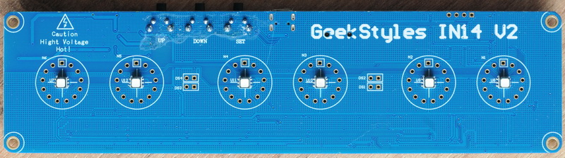
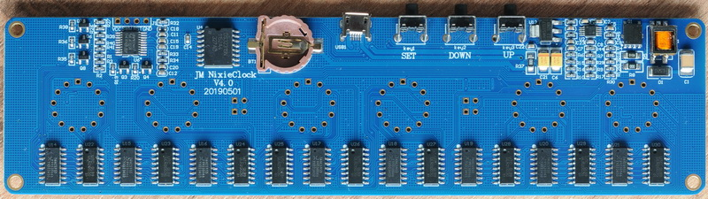
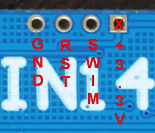

# IN14v2clock

Alternate firmware for the GeekStyles IN14 V2 Nixie clock PCB (6 x IN-14: hours, minutes, seconds).

## Version
- **2.00 RC1** (release candidate): **not tested on the hardware yet**, the board was not at hand while the firmware
  was ported. It builds with both compilers and the logic was checked by models, but the keys, the digits wiring,
  the IN-14 cathode order and the smooth change at a low brightness still need a check on a real clock.
  Please report what does not work. The previous tested firmware is the version 1.00 (the git history, the commit 94c69c4).
  Rework of the firmware, based on [IN12v3clock](https://github.com/siliverst/IN12v3clock) 2.00 (the same platform with 4 tubes):
  - day and night modes with smooth brightness change, separate digits and backlight brightness, the night digits can be off;
  - perceptually linear backlight brightness (CIE lightness), backlight on/off for day and night separately;
  - smooth change of the digits: every changed digit (every second too) fades out and the new one fades in;
  - antipoisoning effects on all 6 tubes, glitches
    (ideas from [NixieClock v2](https://github.com/AlexGyver/NixieClock_v2) by AlexGyver);
  - digits PWM 100/200/400 Hz with flicker free updates, fast 595 shift out (assembler);
  - leading zero, 12/24-hour format, the settings menu by groups with "+" and "-", the night start and end set as a time;
  - DS3231: ~100 kHz I2C, the oscillator is enabled, the lost time (empty battery) is reset to 00:00:00;
  - command line build and flashing (`tools/`), VS Code tasks. Cosmic: ~6 KB of 8 KB.
  - The colon neons are not used (they can be added by those who like them, see [Pinout](#pinout)).
- **1.00**: Initial release.

## Description
This firmware is designed for the IN14 V2 clock PCB,
with frontside inscription: **GeekStyles IN14 V2**
[](Photo/pcb_front_fullsize.JPG)
and the backside inscription: **JM NixieClock V4.0 20190501**.
[](Photo/pcb_back_fullsize.JPG)
The STM8S003F3P6 microcontroller features 8 KB of Flash memory, 1 KB of RAM, and 128 bytes of EEPROM.

---

## Requirements
What to install (Windows):

| Tool | Needed for | Where | Default path (used if no path is set) |
|------|-----------|-------|----------------------------------------|
| **Cosmic CXSTM8** (free license, registration) | build, the main compiler | [cosmicsoftware.com](https://www.cosmicsoftware.com/download_stm8_free.php) | `C:\Program Files (x86)\COSMIC\FSE_Compilers\CXSTM8` |
| **SDCC** 4.x (4.5 is tested) | build, alternative (the binary is ~0.6 KB larger) | [sdcc.sourceforge.net](https://sdcc.sourceforge.net) | `C:\Program Files\SDCC\bin` |
| **Python 3** | build and flash scripts in `tools/` | [python.org](https://www.python.org) | in `PATH` |
| **ST Visual Programmer (STVP)** + ST-LINK driver | flashing (`STVP_CmdLine.exe`) | [st.com](https://www.st.com/en/development-tools/stvp-stm8.html) | `C:\Program Files (x86)\STMicroelectronics\st_toolset\stvp\STVP_CmdLine.exe` |
| **VS Code** + C/C++ extension | editor (optional) | [code.visualstudio.com](https://code.visualstudio.com) | |

Other paths are set in one of the ways (an empty value means the default path):
- VS Code: `.vscode/settings.json`: `in14v2clock.cosmicDir`, `in14v2clock.sdccDir`, `in14v2clock.stvpCmdLine`;
- command line: the environment variables `COSMIC_DIR`, `SDCC_DIR`, `STVP_CMDLINE`.

External libraries: the submodule [STM8_headers](https://github.com/gicking/STM8_headers) (`git clone --recurse-submodules`).

## Working in VS Code
1. Install the tools from the table above. If a tool is not in its default path, set the path in `.vscode/settings.json`.
2. Open the project folder: `File > Open Folder`. VS Code offers the recommended extensions (C/C++, Python), install them.
3. **Build:** `Ctrl+Shift+B`, choose the compiler (`cosmic`, `sdcc` or both). The terminal at the bottom shows the result:
   `COSMIC: ROM 6051 / 8192 (2141 free) ...`. The errors are in the Problems panel (`Ctrl+Shift+M`), a click opens the line.
4. **Other tasks** (flashing etc.): `Terminal > Run Task...` (or `Ctrl+Shift+P` > `Tasks: Run Task`), choose the task:

   | Task | What it does |
   |------|--------------|
   | `Build` | build, asks for the compiler (the same as `Ctrl+Shift+B`) |
   | `Build Cosmic`, `Build SDCC` | build with one compiler, no question |
   | `Flash` | flash through ST-LINK, asks: Cosmic or SDCC firmware or the precompiled one (`Release/`, no build needed), with or without the default EEPROM (the settings reset). Option bytes are not touched |
   | `Build and flash Cosmic` | build and flash at once — the usual one |
   | `Special build Cosmic` | test builds: `AP_TEST` (the time runs 6 times faster, antipoisoning every minute), `DIAG_RESET` (the reset cause at start) |
   | `Default EEPROM file` | regenerate the default EEPROM file after a change of the settings layout |

5. **Flashing:** connect the ST-LINK to the debug connector, power the clock, run `Flash` or `Build and flash Cosmic`.
   Success is two lines in the terminal:
   ```
   <<< Programming PROGRAM MEMORY succeeds
   <<< Verifying PROGRAM MEMORY succeeds
   ```
   `ERROR : Cannot communicate with the device` — the ST-LINK is not connected or the clock has no power.
   The option byte `AFR0` must be set once (see [Flashing](#flashing)), the scripts do not touch the option bytes.
6. **Repeat the last task:** `Ctrl+Shift+P` > `Tasks: Rerun Last Task`. A key can be assigned to it:
   `File > Preferences > Keyboard Shortcuts`, search `Rerun Last Task`.
- Output files: `build/cosmic/in14v2clock.s19`, `build/sdcc/main.s19`. The build fails if the firmware does not fit into 8 KB.

The old STVD project (`in14v2clock.stp`) still works, but VS Code with the scripts is the main way now.

---

## Pinout
### STM8S003F3P6 Microcontroller Pin Assignment
| Pin  | Signal                          | Description                                                                 |
|------|---------------------------------|-----------------------------------------------------------------------------|
| 1    | PD4 (HS) UART1_CK/TIM2_CH1/BEEP | Colon neons DS3 & DS4 (hours:minutes). Not used by this firmware.           |
| 2    | PD5 (HS) UART1_TX/AIN5          | Colon neons DS1 & DS2 (minutes:seconds). Not used by this firmware.         |
| 3    | PD6 (HS) UART1_RX               | Reserved                                                                    |
| 4    | NRST                            | Debug connector pin 3.                                                      |
| 5    | PA1 OSCIN                       | Input: key UP (KEY3, the left one), the firmware key "-". 10k pull-up, grounded when pressed. |
| 6    | PA2 OSCOUT                      | Input: key DOWN (KEY2, the middle one), the firmware key "M". 10k pull-up, grounded when pressed. |
| 7    | Vss                             | GND                                                                         |
| 8    | Vcap                            | Decoupling capacitor                                                        |
| 9    | Vdd                             | +3.3V supply                                                                |
| 10   | PA3 (HS) SPI_NSS/TIM2_CH3       | Input: key SET (KEY1, the right one), the firmware key "+". 10k pull-up, grounded when pressed. |
| 11   | PB5 (T) I2C_SDA/TIM1_BKIN       | I2C SDA for DS3231 RTC with 10k pull-up resistor                            |
| 12   | PB4 (T) I2C_SCL/ADC_ETR         | I2C SCL for DS3231 RTC with 10k pull-up resistor                            |
| 13   | PC3 (HS) TIM1_CH3               | Drives LEDs (red) through 1k resistor                                       |
| 14   | PC4 (HS) TIM1_CH4               | Drives LEDs (blue) through 1k resistor.                                     |
| 15   | PC5 (HS) SPI_SCK/TIM2_CH1       | Drives 595-pin12 RCLK (latch) with 10k pull-up resistor                     |
| 16   | PC6 (HS) SPI_MOSI/TIM1_CH1      | Drives LEDs (green) through 1k resistor                                     |
| 17   | PC7 (HS) SPI_MISO/TIM1_CH2      | Drives 595-pin14 SER (shift register data input) with 10k pull-up resistor  |
| 18   | PD1 (HS) SWIM                   | Debug connector pin 2.                                                      |
| 19   | PD2 (HS) AIN3/TIM2_CH3          | Drives 595-pin13 nOE (output enable U14 only)                               |
| 20   | PD3 (HS) AIN4/TIM2_CH2          | Drives 595-pin11 SRCLK (clock) with 10k pull-up resistor                    |

The keys are named on the board front (from the left) UP, DOWN, SET. The firmware uses them as "-", "M", "+".

### Debug Connector
| Pin | Signal | Description            |
|-----|--------|------------------------|
| 1   | 3.3V   | Power supply.          |
| 2   | SWIM   | Programming interface. |
| 3   | NRST   | Reset.                 |
| 4   | GND    | Ground.                |

---

## Shift Register Wiring
The project uses a chain of 8 74HC595 shift registers, driving 2003A darlington arrays to control the Nixie tubes.
N1 is the right tube (units of seconds), N6 is the left one (tens of hours).
In the firmware the chain bit of a digit is `g = position * 10 + digit` (position 0 is N1), the 64 bits are shifted out
from `frame[0]` bit 7, so `g` is the byte `frame[7 - g / 8]`, the bit `g % 8`; U21 Q4..Q7 are not connected.

```
PC7
|
V
595 U14
Q0 -> 2003A U22 I1, O1-> N1 0
Q1 -> 2003A U22 I2, O2-> N1 1
Q2 -> 2003A U22 I3, O3-> N1 2
Q3 -> 2003A U22 I4, O4-> N1 3
Q4 -> 2003A U22 I5, O5-> N1 4
Q5 -> 2003A U22 I6, O6-> N1 5
Q6 -> 2003A U22 I7, O7-> N1 6
Q7 -> 2003A U23 I1, O1-> N1 7
|
V
595 U15
Q0 -> 2003A U23 I2, O2-> N1 8
Q1 -> 2003A U23 I3, O3-> N1 9
Q2 -> 2003A U23 I4, O4-> N2 0
Q3 -> 2003A U23 I5, O5-> N2 1
Q4 -> 2003A U23 I6, O6-> N2 2
Q5 -> 2003A U23 I7, O7-> N2 3
Q6 -> 2003A U24 I1, O1-> N2 4
Q7 -> 2003A U24 I2, O2-> N2 5
|
V
595 U16
Q0 -> 2003A U24 I3, O3-> N2 6
Q1 -> 2003A U24 I4, O4-> N2 7
Q2 -> 2003A U24 I5, O5-> N2 8
Q3 -> 2003A U24 I6, O6-> N2 9
Q4 -> 2003A U24 I7, O7-> N3 0
Q5 -> 2003A U25 I1, O1-> N3 1
Q6 -> 2003A U25 I2, O2-> N3 2
Q7 -> 2003A U25 I3, O3-> N3 3
|
V
595 U17
Q0 -> 2003A U25 I4, O4-> N3 4
Q1 -> 2003A U25 I5, O5-> N3 5
Q2 -> 2003A U25 I6, O6-> N3 6
Q3 -> 2003A U25 I7, O7-> N3 7
Q4 -> 2003A U26 I1, O1-> N3 8
Q5 -> 2003A U26 I2, O2-> N3 9
Q6 -> 2003A U26 I3, O3-> N4 0
Q7 -> 2003A U26 I4, O4-> N4 1
|
V
595 U18
Q0 -> 2003A U26 I5, O5-> N4 2
Q1 -> 2003A U26 I6, O6-> N4 3
Q2 -> 2003A U26 I7, O7-> N4 4
Q3 -> 2003A U27 I1, O1-> N4 5
Q4 -> 2003A U27 I2, O2-> N4 6
Q5 -> 2003A U27 I3, O3-> N4 7
Q6 -> 2003A U27 I4, O4-> N4 8
Q7 -> 2003A U27 I5, O5-> N4 9
|
V
595 U19
Q0 -> 2003A U27 I6, O6-> N5 0
Q1 -> 2003A U27 I7, O7-> N5 1
Q2 -> 2003A U28 I1, O1-> N5 2
Q3 -> 2003A U28 I2, O2-> N5 3
Q4 -> 2003A U28 I3, O3-> N5 4
Q5 -> 2003A U28 I4, O4-> N5 5
Q6 -> 2003A U28 I5, O5-> N5 6
Q7 -> 2003A U28 I6, O6-> N5 7
|
V
595 U20
Q0 -> 2003A U28 I7, O7-> N5 8
Q1 -> 2003A U29 I1, O1-> N5 9
Q2 -> 2003A U29 I2, O2-> N6 0
Q3 -> 2003A U29 I3, O3-> N6 1
Q4 -> 2003A U29 I4, O4-> N6 2
Q5 -> 2003A U29 I5, O5-> N6 3
Q6 -> 2003A U29 I6, O6-> N6 4
Q7 -> 2003A U29 I7, O7-> N6 5
|
V
595 U21
Q0 -> 2003A U30 I1, O1-> N6 6
Q1 -> 2003A U30 I2, O2-> N6 7
Q2 -> 2003A U30 I3, O3-> N6 8
Q3 -> 2003A U30 I4, O4-> N6 9
Q4 -> Not connected
Q5 -> Not connected
Q6 -> Not connected
Q7 -> Not connected
```

---

## Usage
1. Clone the repository with submodules:
   ```bash
   git clone --recurse-submodules <repository_url>
   ```

 **When using COSMIC:**
 - Compile the firmware using Cosmic STM8 v4.6 toolchain (VS Code, `python tools/build.py cosmic` or the STVD project
   `in14v2clock.stp`, configuration Release).
 - Or use precompiled firmware file: `Release\in14v2clock.s19` 

 **When using SDCC:**
 - Windows: VS Code task `Build SDCC` or `python tools/build.py sdcc` (see below).
 - Linux / macOS: install `sdcc` (4.5 is tested, older versions may not fit into 8 KB), `make`, `binutils`, then in the project folder:
   - `make` — build to `build/sdcc/main.ihx` and `main.s19`, `make clean` — remove the build;
   - `make flash` — flash through ST-LINK V2 with [stm8flash](https://github.com/vdudouyt/stm8flash) (option bytes and EEPROM are not touched).
 - Or use the precompiled files (`main.s19` or `main.ihx`) located in the `SDCC` directory.

 **Command line build on Windows (no STVD):**
 - Requires Python 3 and installed Cosmic CXSTM8 and/or SDCC (default install paths, or set `COSMIC_DIR` / `SDCC_DIR`).
 - `python tools/build.py` builds with both compilers, `python tools/build.py cosmic` or `... sdcc` builds with one.
 - Results go to `build/cosmic/in14v2clock.s19` and `build/sdcc/main.s19`; the script prints ROM/RAM usage and fails if the firmware does not fit into 8 KB.
 - Note: the Cosmic optimizer must be enabled (no option `-no`), it saves about 540 bytes.
 - Build options: `-DDIAG_RESET` (shows the reset cause at start: `8 _ _ _ x x`), `-DAP_TEST` (test: the time runs 6 times
   faster, antipoisoning every minute).
 - `python tools/eedata.py` regenerates the default EEPROM file from the sources (after a change of the settings layout).
 - `python tools/flash.py [release] [sdcc] [data]` flashes `build/cosmic/in14v2clock.s19` through ST-LINK (SWIM) with `STVP_CmdLine`, option bytes are not touched; `data` also writes the default EEPROM file; `release` flashes the precompiled `Release/in14v2clock.s19` (no compiler needed).
2. Flash the firmware, see [Flashing](#flashing).
3. Verify the board's functionality.

## Flashing
The STM8S003F3 has no UART bootloader, it is flashed only through **SWIM** with an **ST-LINK V2** (an original or a cheap clone).

**Connection** — the debug connector of the board (see [Debug Connector](#debug-connector)):
- ST-LINK `SWIM` -> pin 2, `RST` -> pin 3, `GND` -> pin 4;
- power the clock from its own power supply. Pin 1 (3.3V): an original ST-LINK only measures the target voltage there,
  a clone outputs 3.3V — with the clock powered by its supply it is safer not to connect it.



The pinout of your ST-LINK: [Wiki: ST-Link Pinout](https://wiki.cuvoodoo.info/doku.php?id=jtag)

**Option byte `AFR0` (once for a new chip):** the backlight green channel is TIM1_CH1 on PC6, it is available only
with the alternate function remapping `AFR0` (Port C5, C6, C7 — alternate function). Without it the green LEDs do not work.
The file `in14v2clock_Programmer/in14v2clock_STVP_OPTION BYTE.hex` has this setting, the scripts below never write the option bytes.

**Files:**
- firmware: `Release/in14v2clock.s19` (precompiled, Cosmic) or your build `build/cosmic/in14v2clock.s19`;
  SDCC: `SDCC/main.s19` / `build/sdcc/main.s19`;
- default settings (EEPROM): `in14v2clock_Programmer/in14v2clock_STVP_data.s19` (`.hex`). Not needed: the firmware writes
  the default settings itself if the EEPROM is empty or has an old layout (the settings of the firmware 1.00 are reset).

### Windows: ST Visual Programmer (STVP), GUI
Install [STVP](https://www.st.com/en/development-tools/stvp-stm8.html) (it also installs the ST-LINK driver).
1. Open the project `in14v2clock_Programmer/in14v2clock_STVP.stp` (`File > Open Project`). It is set for ST-LINK, SWIM,
   STM8S003F3 and loads the files: PROGRAM MEMORY — `Release/in14v2clock.s19`, DATA MEMORY — the default settings,
   OPTION BYTE — `AFR0`. If a file is not found, load it by `File > Open...` on its tab.
   Without the project: `Configure > Configure ST Visual Programmer`: Hardware `ST-LINK`, Port `USB`, Programming mode `SWIM`,
   Device `STM8S003F3`; then load the files on the tabs.
2. A new chip: tab **OPTION BYTE**, check that `AFR0` is `Port C5... Alternate Active`, then `Program > Current tab`.
3. Tab **PROGRAM MEMORY**: `Program > Current tab` (Ctrl+P). The verify runs after the programming.
4. Tab **DATA MEMORY** (optional, resets the settings to the defaults): `Program > Current tab`.

`Program > All tabs` writes all three at once (the settings are reset).

### Windows: command line or VS Code
`python tools/flash.py [release] [sdcc] [data]` or the VS Code task `Flash` (see [Working in VS Code](#working-in-vs-code)).
It uses `STVP_CmdLine.exe` from STVP, writes the program memory (and the default EEPROM with `data`), verifies it,
never touches the option bytes. Set `AFR0` once with the STVP GUI.

### Linux / macOS: stm8flash
[stm8flash](https://github.com/vdudouyt/stm8flash) works with ST-LINK V2 (on Linux add the udev rule from its README
or run with `sudo`):
```bash
make flash                                                   # build/sdcc/main.ihx, the same as:
stm8flash -c stlinkv2 -p stm8s003f3 -s flash -w build/sdcc/main.ihx
stm8flash -c stlinkv2 -p stm8s003f3 -s flash -w Release/in14v2clock.s19          # the precompiled Cosmic firmware
stm8flash -c stlinkv2 -p stm8s003f3 -s eeprom -w in14v2clock_Programmer/in14v2clock_STVP_data.hex   # settings reset (optional)
# option bytes, once for a new chip: OPT0..NOPT5 with AFR0 = 1 (OPT2 = 0x01, NOPT2 = 0xFE)
printf '\x00\x00\xff\x01\xfe\x00\xff\x00\xff\x00\xff' > opt.bin
stm8flash -c stlinkv2 -p stm8s003f3 -s opt -w opt.bin
```
The stm8flash commands are not tested by the author on this board (the Windows way is).

---

# **Clock Control and Setup Guide**

<details>
<summary>Show Full Instruction</summary>

## **Keys:**
- **"-"** — the left key (UP on the board).
- **"M"** — the middle key (DOWN on the board).
- **"+"** — the right key (SET on the board).

---

## **Time Display:**
The tubes show `HH MM SS`.
1. **Click "+"** — Shows the number of the cathode poisoning prevention effect (menu item 4.2) in the right tube.
   Click again while the number is shown to switch to the next effect. 1.5 s after the last click the effect runs.
2. **Click "M"** — Shows the smooth change setting (menu item 4.1, `0` — off, `1` — on) in the left tube.
   Click again while it is shown to switch it. 1.5 s after the last click the time appears.
   A single click never changes an effect: the first click only shows it.
3. **Click "-"** — Switches the RGB backlight on/off for the current interval (day or night).
   Day and night have their own on/off state and brightness (menu items 2.3 and 2.4).
   If the backlight brightness of the current interval is 0, the backlight blinks 3 times and stays off.
4. **Hold "+" (2 seconds)** — Time setup.
5. **Hold "M" (2 seconds)** — Settings menu.
6. **Hold "-" (2 seconds)** — Backlight color setup.

The brightness changes smoothly (day/night, backlight on/off): digits and backlight 1% every 50 ms,
the backlight switched by "-" 4% every 50 ms.

---

## **Time Setup:**
1. **Entering:** hold "+" for 2 seconds. The hours blink.
2. **"+" / "-"** — change the blinking value by 1 (hold for auto repeat: after 0.8 s 5 per second, after 1.8 s 10 per second).
3. **"M"** — hours → minutes → seconds → the time is saved and the clock returns to the time display.

In the 12-hour format the hours are set as 12, 1…11: AM — the hours blink slowly, PM — the hours blink fast.

If the RTC battery was empty or removed while the clock was off (DS3231 oscillator stop flag),
the clock starts at 00:00:00 — set the time again.

---

## **Backlight Color Setup:**
1. **Entering:** hold "-" for 2 seconds. The backlight is on at full brightness.
2. The left tube shows the blinking channel number: `1` — red, `2` — green, `3` — blue; the right tubes show its value 0–255.
3. **"+" / "-"** — change the value (hold for auto repeat).
4. **"M"** — save the channel and go to the next one, after blue — exit.

---

## **Settings Menu:**
1. **Entering:** hold "M" for 2 seconds.
2. **Display:** the item number "group item" in the two left tubes (at full brightness), the value in the right tubes.
   The night start and end: the time `HH MM` in the four right tubes, the edited part blinks.
3. **Control:**
   - **"+" / "-"** — change the value (hold for auto repeat for the values above 9). The brightness stops at its limits,
     the other values go in a circle.
   - **"M" (short)** — save the item and move to the next one, after the last one — exit.
   - **"M" (hold 1 s)** — save the item and exit the menu.
   - Without key presses the menu (and the time and color setup) is left after 60 seconds, not saved values are dropped.
4. **Menu items:**

    **1. Display**  
    **1.1** Leading zero of the hours: `0` — blank (` 7 05 00`), `1` — shown (`07 05 00`)  
    **1.2** Time format: `0` — 24-hour, `1` — 12-hour (no AM/PM on the time display; in the time setup PM is shown by the fast blinking hours; the night interval is always in 24-hour format)  

    **2. Brightness** (the item shows the brightness being set)  
    **2.1** Digits, day: `5–100%`  
    **2.2** Digits, night: `0, 5–100%` (`0` — digits are off at night)  
    **2.3** Backlight, day: `0–100%`, perceptually linear (CIE lightness)  
    **2.4** Backlight, night: `0–100%`  
    **2.5** Digits PWM frequency: `0` — 100 Hz (default), `1` — 200 Hz, `2` — 400 Hz (experimental: at a low brightness some cathodes may not glow fully); shown at the night brightness to see the flicker  

    **3. Night**  
    **3.1** Night interval: `0` — Off (day settings all the time), `1` — On  
    **3.2** Night start `HH MM` (24-hour)  
    **3.3** Night end `HH MM`  

    **4. Effects**  
    **4.1** Smooth change of the digits: `0` — Off, `1` — On (every changed digit fades out in 0.25 s and the new one fades in, every second too)  
    **4.2** Cathode poisoning prevention effect (every digit of all 6 tubes goes through all 10 cathodes):  
         `0` — Wave: the digits roll down one after another from the shown digits to the time (2 s)  
         `1` — Wave through the cathodes in their order in the tube  
         `2` — Noise: all digits roll fast together (0.5 s)  
    **4.3** Cathode poisoning prevention interval, day: `0` — Off, `1–30` minutes  
    **4.4** Cathode poisoning prevention interval, night: `0` — Off, `1–30` minutes (not done if the night digits brightness is 0)  
    **4.5** Glitches: `0` — Off, `1` — On (every 30–120 s a random tube flickers a few times)  

</details>

---

## License
This project is distributed under the **MIT License**.
